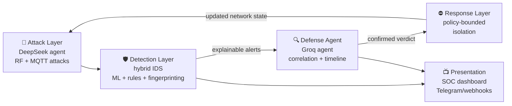

<div align="center">

# ⓪ CERBERUS

**Multi-layer intrusion detection · policy-bounded automated response · RF-resilience testing**
**for Wi-Fi / MQTT IoT networks**

[](https://www.python.org/)
[](docs/PLAN.md)
[](requirements.txt)
[](docs/PLAN.md)

*A closed-loop security platform that sees attacks at both the RF and protocol layers,
**explains** every detection, and isolates confirmed attackers — no human in the loop.*

</div>

---

## Why CERBERUS exists

Low-cost IoT security setups fail in three predictable ways — CERBERUS closes each gap:

| # | Gap | CERBERUS answer |
|---|-----|-----------------|
| 1 | Monitoring covers *either* the RF/802.11 layer *or* the MQTT protocol layer | Hybrid engine watches **both simultaneously** |
| 2 | ML detections are black boxes nobody can act on | Every alert ships **SHAP/LIME-backed attributions** + rule reasons |
| 3 | Response waits for a human, so attackers keep moving | **Policy-bounded automated isolation** of confirmed malicious endpoints |

## Architecture

Five-layer closed loop — attacks are generated, detected, investigated, and neutralized:



| Module | Responsibility |
|---|---|
| [`agents/`](agents/) | LLM agents via tool-calling scaffolds — **DeepSeek** = attack agent, **Groq** = defense agent |
| [`detection/`](detection/) | Hybrid IDS: Isolation Forest + autoencoder, deterministic rules, device fingerprinting, SHAP/LIME |
| [`gateway/`](gateway/) | MQTT telemetry, PCAP capture, endpoint isolation (Linux gateway) |
| [`backend/`](backend/) | Flask REST API + SQLite: alerts, devices, incident timelines, audit log |
| [`frontend/`](frontend/) | Vanilla HTML/CSS/JS SOC dashboard — no frameworks |
| [`firmware/`](firmware/) | ESP-IDF C/C++ for ESP32 (`esp_wifi_80211_tx()`) + NRF24L01 — Phases 2–3 |

## Key properties

- **Explainable by design** — no black-box detections. Fused confidence score + per-feature SHAP attribution + fired-rule reasons on every alert.
- **Router-agnostic** — zero dependency on OpenWrt or custom firmware. Capture, injection, and isolation run on ESP32 nodes and a plain Linux gateway.
- **Guardrailed agents** — both LLM agents act only through structured function-calling with scope-locking (protected infrastructure is untouchable) and rate limiting.
- **Full evidence trail** — every alert persists its raw feature snapshot, so any decision is reproducible later. Every mutation is audit-logged.

## Quickstart

```powershell
# 1. Environment (Python 3.12 64-bit — see note below)
py -3.12 -m venv .venv
.venv\Scripts\pip install -r requirements.txt

# 2. Secrets
copy .env.example .env        # fill in DEEPSEEK_API_KEY, GROQ_API_KEY, TELEGRAM_BOT_TOKEN

# 3. Seed a demo database (simulated traffic → detection → SHAP → SQLite)
.venv\Scripts\python scripts\seed_demo.py

# 4. Open the SOC dashboard
#    → http://127.0.0.1:5000/
```

> ⚠️ **Python version matters.** Use **3.12 (64-bit)**. Python 3.14/3.13 have no prebuilt wheels
> for the scipy/scikit-learn/shap stack yet, and 32-bit builds fail on memory.
>
> Run the backend as a **module**: `python -m backend.app` — `python backend\app.py` breaks `import config`.

## SOC dashboard

Real-time view with 5-second polling: live alert table (filterable by status), per-device
status with isolate action, per-alert breakdown of confidence / ML anomaly / rules /
fingerprint scores, SHAP attribution, rule reasons, and incident timelines.

```
29 ALERTS   29 OPEN   4 DEVICES   1 ISOLATED   1 INCIDENT
──────────────────────────────────────────────────────────────
#26  02:27  cam-1      DoS        1.00   open
#29  02:27  thermo-2   Spoofing   0.55   open
 ...
```

## REST API

| Endpoint | Method | Purpose |
|---|---|---|
| `/api/alerts` | `GET` `POST` | List (filter by status) / batch-ingest alerts |
| `/api/alerts/{id}` | `GET` | Full alert record incl. feature snapshot |
| `/api/alerts/{id}/status` | `POST` | `open` → `acknowledged` / `resolved` / `false_positive` |
| `/api/devices` | `GET` | Device registry (first/last seen, status) |
| `/api/devices/{id}/status` | `PUT` | `trusted` / `suspicious` / `isolated` |
| `/api/incidents` | `GET` `POST` | Investigations |
| `/api/incidents/{id}/timeline` | `GET` `POST` | Incident timeline events |
| `/api/audit` | `GET` | Audit trail (every mutation) |

## Detection pipeline

```text
traffic ──► rules (7 explainable signatures)          ─┐
        ──► Isolation Forest + autoencoder (benign-   ├─► fused score ─► alert
            trained, quantile-calibrated)            │    (0.5·ML + 0.35·rules
        ──► device fingerprinting (z-deviation,      │     + 0.15·fingerprint)
            new-device flag)                         ┘        │
                                                              ▼
                                        SHAP attribution + reason strings
```

## Verification

```powershell
.venv\Scripts\ruff.exe check .          # lint
.venv\Scripts\python -m pytest tests -q # 95 tests
```

## Roadmap

| Phase | Scope | Status |
|---|---|---|
| **1 — Software core** | Full pipeline on CICIoT2023 + simulated traffic (detection, explainability, backend, dashboard, alerting, agents, policy-bounded response) | 🟢 complete — see [`docs/PLAN.md`](docs/PLAN.md) |
| **2 — Physical testbed** | 4–5 ESP32 nodes + Mosquitto gateway, live attacks, re-validation with confidence intervals | ⚪ planned |
| **3 — RF resilience** | NRF24L01 interference inside shielded enclosure; accuracy/false-alarm degradation | ⚪ stretch goal |

## Safety & compliance

- All RF/attack testing happens **inside a physically shielded enclosure** per NTRA RF regulations.
- No attack traffic is ever generated outside the lab testbed.
- Automated isolation is **policy-bounded**: only endpoints confirmed by the defense agent, never blanket responses.

## Acknowledgments

- **[CICIoT2023](https://www.unb.ca/cic/datasets/iotdataset-2023.html)** dataset (Neto et al., Canadian Institute for Cybersecurity, CC BY 4.0)
- [DeepSeek](https://www.deepseek.com/) · [Groq](https://groq.com/) · [scikit-learn](https://scikit-learn.org/) · [SHAP](https://github.com/shap/shap) · [Mosquitto](https://mosquitto.org/)
